# Testes Caixa Cinza — API de Autenticação com Supabase

**Aluno:** Lucas Torres Fernandes  
**RA:** 251217  
**Instituição:** FACENS  
**Curso:** Análise e Desenvolvimento de Sistemas  
**Data de execução:** 26/11/2026  

---

## Introdução

Este projeto apresenta a execução de testes caixa cinza em uma API de autenticação utilizando a plataforma Supabase e a ferramenta Postman.

Os testes caixa cinza são realizados quando o responsável pelos testes possui conhecimento parcial da estrutura interna do sistema. Nesta atividade, foram utilizadas informações sobre o endpoint da API, método HTTP, headers, parâmetros, corpo da requisição e respostas esperadas.

A atividade foi desenvolvida individualmente, sem a necessidade de implementação de uma interface gráfica, com foco na validação funcional do processo de autenticação.

## Objetivo da Atividade

O objetivo desta atividade é compreender e aplicar testes caixa cinza em uma API de autenticação, utilizando ferramentas de mercado para configuração, execução, validação e documentação dos testes.

Os objetivos específicos são:

- Configurar um ambiente de autenticação utilizando Supabase.
- Criar um usuário para realização dos testes.
- Compreender o funcionamento das requisições HTTP.
- Configurar e utilizar o Postman Desktop.
- Validar respostas de autenticação.
- Identificar o comportamento da API diante de entradas válidas e inválidas.
- Documentar os resultados obtidos.

### Ferramentas utilizadas

| Ferramenta | Finalidade |
|---|---|
| Supabase | Configuração e disponibilização da API de autenticação |
| Postman Desktop | Configuração e execução das requisições HTTP |
| Microsoft Excel | Registro e organização dos resultados |
| Visual Studio Code | Organização dos arquivos e documentação |
| GitHub | Armazenamento e disponibilização do projeto |

## Configuração do Supabase

Inicialmente, foi criado um projeto no Supabase com o nome `Teste_Caixa_Cinza`, utilizando o plano gratuito da plataforma.

O ambiente foi configurado na região East US (Ohio), disponibilizando os recursos necessários para a execução dos testes de autenticação.

### Criação do projeto

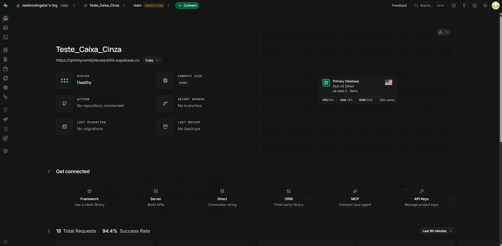

### Configuração da autenticação

Foi utilizado o método de autenticação por e-mail e senha, disponibilizado pelo Supabase Authentication.

O provedor de autenticação por e-mail foi habilitado e o tamanho mínimo de senha estava configurado para seis caracteres.

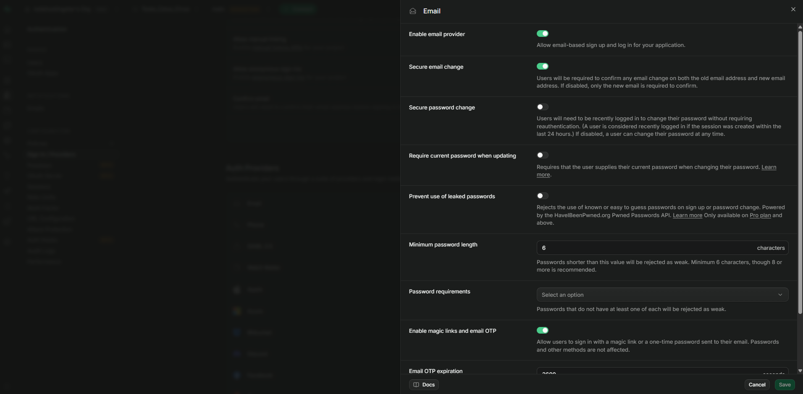

### Criação do usuário

Foi criado um usuário específico para a realização dos testes, utilizando um endereço de e-mail associado ao RA do aluno.

| Campo | Informação |
|---|---|
| E-mail | 251217@lucas.com |
| Provedor | Email |
| Senha | Protegida por motivos de segurança |
| Finalidade | Testes de autenticação |

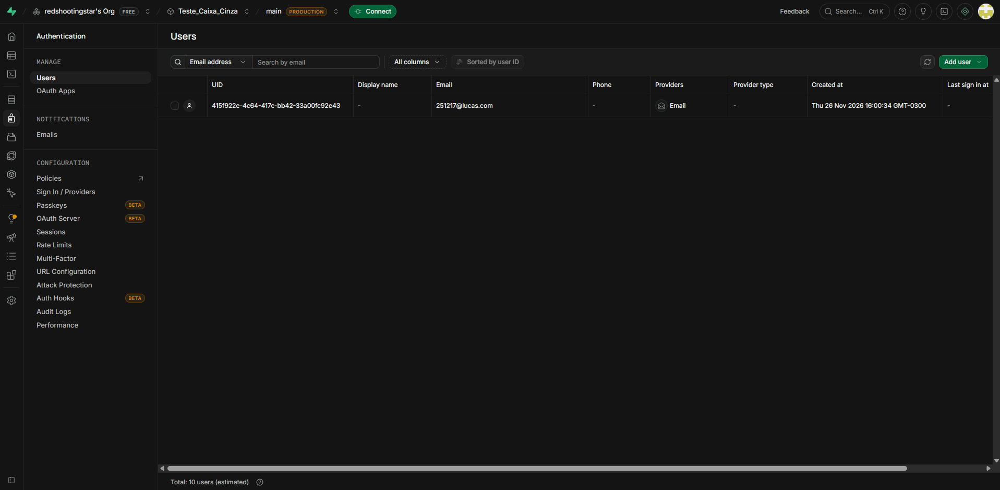

### Credenciais da API

Após a criação do projeto, foram identificadas as informações necessárias para acessar a API de autenticação:

- URL do projeto Supabase.
- Chave pública da API.
- E-mail do usuário cadastrado.
- Senha do usuário cadastrado.

Para a execução das requisições, foi utilizada a chave pública legada `anon`, compatível com a configuração dos headers utilizados nesta atividade.

As credenciais sensíveis não devem ser disponibilizadas no repositório público.

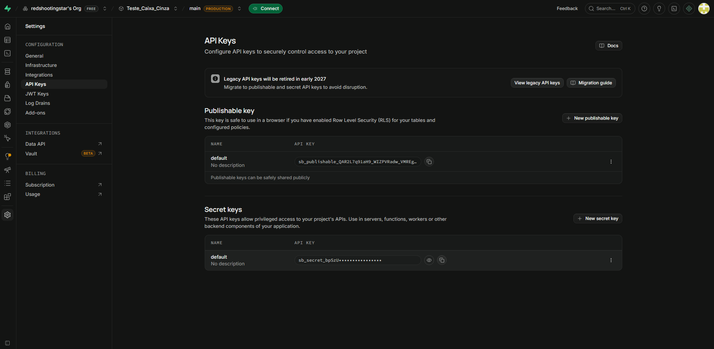

## Configuração do Postman

O Postman Desktop foi utilizado para configurar, organizar e executar as requisições HTTP direcionadas à API de autenticação do Supabase.

### Criação do Workspace

Foi criado um Workspace denominado `Teste_Caixa_Cinza`, destinado exclusivamente à organização dos testes desta atividade.

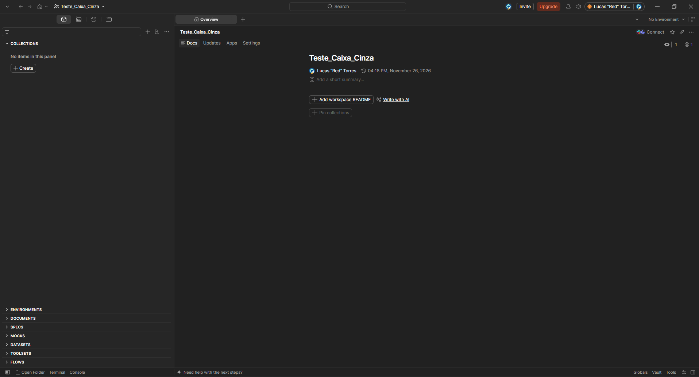

### Configuração do Environment

Foi criado um Environment denominado `Supabase_Auth`, contendo quatro variáveis utilizadas nas requisições.

| Variável | Finalidade |
|---|---|
| base_url | Armazenar a URL da API do Supabase |
| api_key | Armazenar a chave pública da API |
| email | Armazenar o e-mail do usuário de teste |
| password | Armazenar a senha do usuário de teste |

A utilização de variáveis permite reutilizar informações entre diferentes requisições, evitando a necessidade de inserir manualmente as credenciais em cada teste.

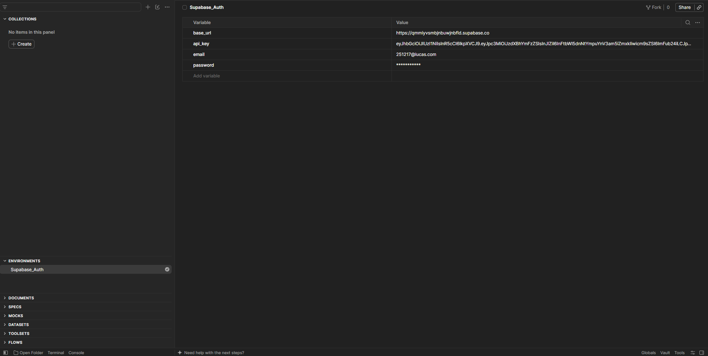

### Criação da Collection

Foi criada a Collection `Testes_Autenticacao_Supabase`, responsável por armazenar e organizar os cinco cenários de teste.

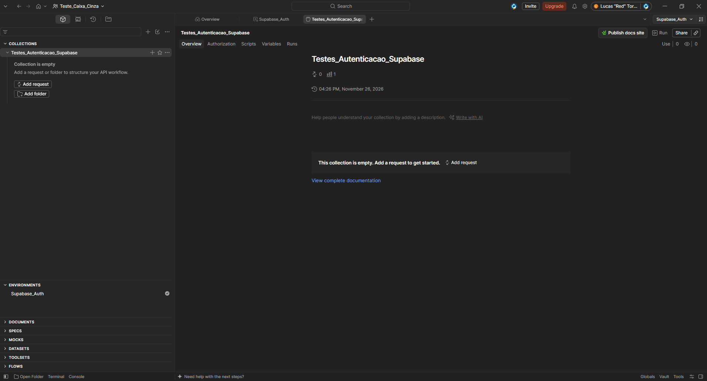

## Configuração das Requisições

Para realizar os testes de autenticação, foi utilizado o método HTTP POST, responsável por enviar os dados de login para a API.

### Endpoint utilizado

```http
POST /auth/v1/token?grant_type=password
```

A URL configurada no Postman foi:

```text
{{base_url}}/auth/v1/token?grant_type=password
```

O parâmetro `grant_type=password` indica que a autenticação será realizada utilizando as credenciais do usuário.

### Headers

| Header | Valor |
|---|---|
| apikey | {{api_key}} |
| Authorization | Bearer {{api_key}} |
| Content-Type | application/json |

O header `apikey` identifica a chave utilizada para acessar a API. O header `Authorization` foi configurado utilizando a chave pública legada no formato Bearer, enquanto o `Content-Type` informa que os dados enviados estão no formato JSON.

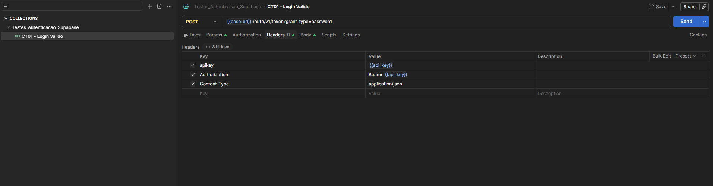

### Body JSON

Exemplo ilustrativo da estrutura utilizada para enviar as credenciais:

```json
{
    "email": "usuario@email.com",
    "password": "123456"
}
```

Na requisição de login válido, foram utilizadas as variáveis configuradas no Environment:

```json
{
    "email": "{{email}}",
    "password": "{{password}}"
}
```

Essa configuração permite enviar as credenciais sem armazenar diretamente a senha no corpo da requisição exportada.

## Execução dos Testes

Foram executados cinco cenários de teste, sendo um cenário positivo e quatro cenários negativos.

O cenário positivo teve como objetivo verificar se um usuário cadastrado consegue realizar a autenticação. Os cenários negativos verificaram se a API rejeita entradas inválidas ou incompletas.

### Tabela de cenários

| ID | Cenário | Entrada utilizada | Resultado esperado | Resultado obtido | Status |
|---|---|---|---|---|---|
| CT01 | Login válido | E-mail e senha corretos | HTTP 200 e access token | HTTP 200 e access token | Sucesso |
| CT02 | Senha incorreta | E-mail correto e senha incorreta | Erro de autenticação | HTTP 400 | Sucesso |
| CT03 | Usuário inexistente | E-mail inexistente e senha válida | Acesso negado | HTTP 400 | Sucesso |
| CT04 | Campos vazios | E-mail e senha vazios | Erro de validação | HTTP 400 | Sucesso |
| CT05 | Credenciais inválidas | E-mail e senha incorretos | Mensagem de erro | HTTP 400 | Sucesso |

### CT01 — Login válido

Neste cenário, foram utilizadas as credenciais corretas do usuário cadastrado no Supabase.

**Entrada utilizada:**

```json
{
    "email": "{{email}}",
    "password": "{{password}}"
}
```

**Resultado esperado:** autenticação realizada com sucesso e retorno de um access token.

**Resultado obtido:**

- Status HTTP: 200 OK.
- Tempo de resposta: 1.310 ms.
- Access token retornado.
- Refresh token retornado.
- Tipo de token: Bearer.
- Validade do access token: 3.600 segundos.
- Status do teste: Sucesso.

O retorno confirmou que o usuário foi autenticado corretamente.

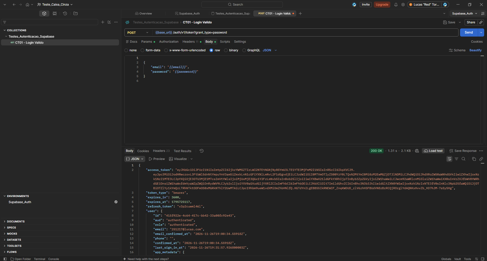

### CT02 — Senha incorreta

Neste cenário, foi utilizado o e-mail do usuário cadastrado, acompanhado de uma senha incorreta.

**Resultado esperado:** rejeição da autenticação.

**Resposta obtida:**

```json
{
    "code": 400,
    "error_code": "invalid_credentials",
    "msg": "Invalid login credentials"
}
```

- Status HTTP: 400 Bad Request.
- Tempo de resposta: 774 ms.
- Status do teste: Sucesso.

A API rejeitou corretamente a tentativa de autenticação e não retornou um token de acesso.

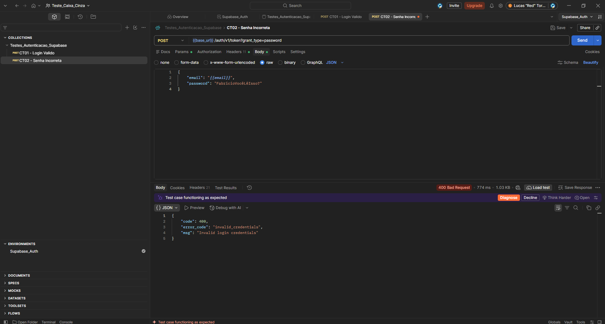

### CT03 — Usuário inexistente

Neste cenário, foi utilizado um endereço de e-mail não cadastrado no ambiente, acompanhado da senha do usuário válido.

**Resultado esperado:** acesso negado.

**Resposta obtida:**

```json
{
    "code": 400,
    "error_code": "invalid_credentials",
    "msg": "Invalid login credentials"
}
```

- Status HTTP: 400 Bad Request.
- Tempo de resposta: 1.040 ms.
- Status do teste: Sucesso.

A API rejeitou a autenticação e apresentou uma mensagem genérica de credenciais inválidas, sem informar explicitamente se o endereço de e-mail estava cadastrado.

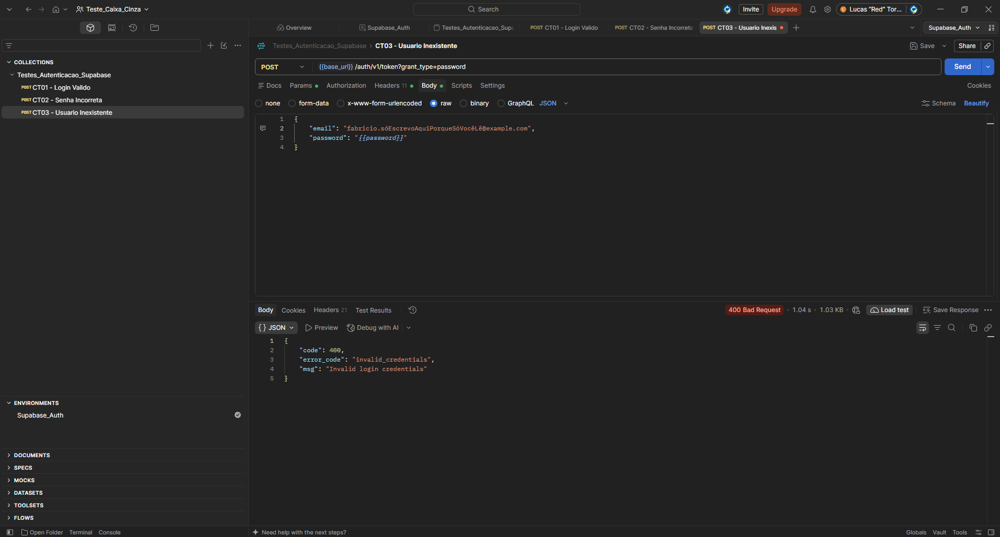

### CT04 — Campos vazios

Neste cenário, foram enviados os campos de e-mail e senha sem preenchimento.

**Entrada utilizada:**

```json
{
    "email": "",
    "password": ""
}
```

**Resultado esperado:** erro de validação.

**Resposta obtida:**

```json
{
    "code": 400,
    "error_code": "validation_failed",
    "msg": "missing email or phone"
}
```

- Status HTTP: 400 Bad Request.
- Tempo de resposta: 826 ms.
- Status do teste: Sucesso.

A API identificou a ausência de uma informação obrigatória e rejeitou a requisição antes de realizar a autenticação.

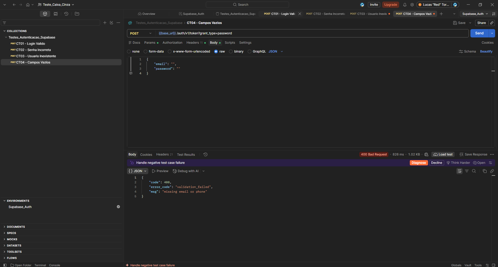

### CT05 — Credenciais inválidas

Neste cenário, foram utilizados simultaneamente um endereço de e-mail inexistente e uma senha incorreta.

**Resultado esperado:** rejeição da autenticação e apresentação de uma mensagem de erro.

**Resposta obtida:**

```json
{
    "code": 400,
    "error_code": "invalid_credentials",
    "msg": "Invalid login credentials"
}
```

- Status HTTP: 400 Bad Request.
- Tempo de resposta: 965 ms.
- Status do teste: Sucesso.

A API rejeitou corretamente as credenciais fornecidas, impedindo a autenticação.

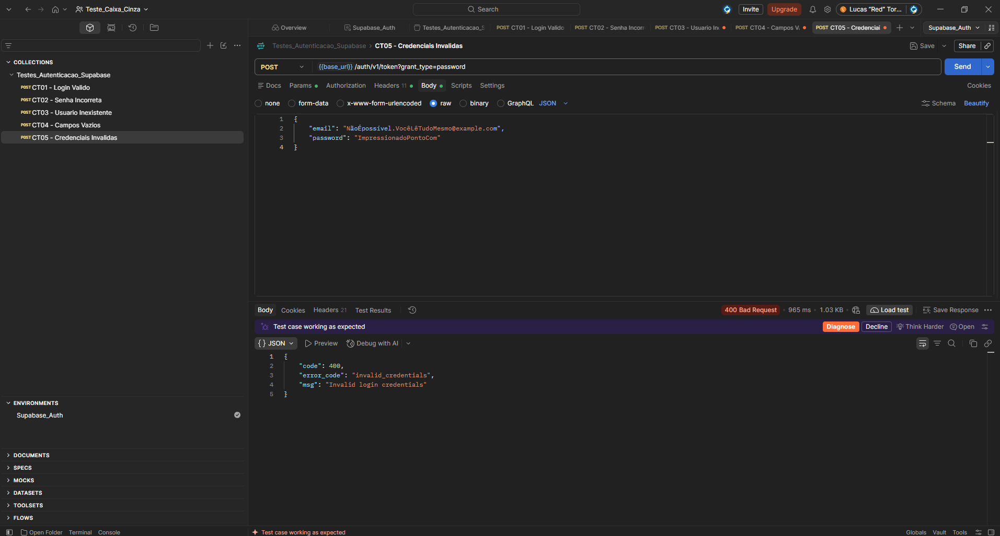

## Registro dos Testes

Os resultados foram organizados em uma planilha Excel, contendo os seguintes campos:

- ID do teste.
- Cenário.
- Entrada utilizada.
- Resultado esperado.
- Resultado obtido.
- Status.
- Observações.
- Tempo de resposta.
- Evidência correspondente.

O registro dos testes permite comparar os resultados esperados com os resultados reais, facilitando a identificação de inconsistências e a reprodução dos cenários.

Nenhuma falha funcional foi identificada nos cinco cenários executados.

### Planilha de testes

[Consultar planilha completa de testes](planilha/Registro_Testes.xlsx)

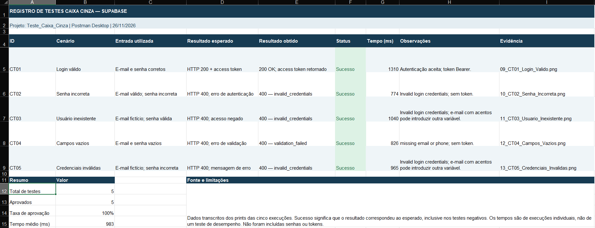

## Resultados Obtidos

Após a execução dos cinco cenários, foi possível verificar que a API apresentou o comportamento esperado diante das entradas utilizadas.

### Resumo dos resultados

| Indicador | Resultado |
|---|---|
| Total de testes executados | 5 |
| Cenários positivos | 1 |
| Cenários negativos | 4 |
| Testes aprovados | 5 |
| Testes reprovados | 0 |
| Taxa de aprovação | 100% |
| Tempo médio de resposta | 983 ms |
| Menor tempo de resposta | 774 ms |
| Maior tempo de resposta | 1.310 ms |

### Comparação dos tempos de resposta

| Cenário | Tempo de resposta |
|---|---|
| CT01 — Login válido | 1.310 ms |
| CT02 — Senha incorreta | 774 ms |
| CT03 — Usuário inexistente | 1.040 ms |
| CT04 — Campos vazios | 826 ms |
| CT05 — Credenciais inválidas | 965 ms |

Os tempos registrados correspondem às execuções individuais realizadas durante a atividade e não representam um teste específico de desempenho ou carga.

### Análise dos resultados

O cenário de login válido confirmou que a API permite a autenticação de um usuário cadastrado mediante a utilização das credenciais corretas.

Os cenários negativos apresentaram respostas HTTP 400, acompanhadas de mensagens relacionadas aos dados inválidos ou ausentes.

Nos testes CT02, CT03 e CT05, a API retornou a mesma mensagem de credenciais inválidas. Esse comportamento evita informar explicitamente se determinado usuário está cadastrado no sistema.

No teste CT04, foi retornada uma mensagem específica de erro de validação, demonstrando que a API identificou a ausência de informações obrigatórias.

Os erros HTTP apresentados nos cenários negativos não representam falhas nos testes, pois correspondem ao comportamento esperado.

Como limitação, os endereços de e-mail fictícios utilizados nos testes CT03 e CT05 continham caracteres acentuados. Em futuras execuções, recomenda-se utilizar endereços fictícios com caracteres convencionais, permitindo um maior controle das variáveis testadas.

A taxa de aprovação de 100% corresponde exclusivamente aos cinco cenários executados, não sendo suficiente para afirmar que a API está livre de outras falhas.

### Estrutura do repositório

```text
Teste_Caixa_Cinza/
├── README.md
├── postman/
│   ├── Testes_Autenticacao_Supabase.postman_collection.json
│   └── Supabase_Auth.postman_environment.json
├── prints/
│   ├── 01_Dashboard.png
│   ├── 02_Autenticacao_email.png
│   ├── 03_Usuario_Criado.png
│   ├── 04_Credenciais_API.png
│   ├── 05_Workspace_Criado.png
│   ├── 06_Variaveis_Configuradas.png
│   ├── 07_Collection_Criada.png
│   ├── 08_Endpoint_Headers.png
│   ├── 09_CT01_Login_Valido.png
│   ├── 10_CT02_Senha_Incorreta.png
│   ├── 11_CT03_Usuario_Inexistente.png
│   ├── 12_CT04_Campos_Vazios.png
│   ├── 13_CT05_Credenciais_Invalidas.png
│   └── 14_Planilha_Preenchida.png
└── planilha/
    └── Registro_Testes.xlsx
```

### Reprodução dos testes

Para reproduzir os testes realizados:

1. Importar a Collection disponível na pasta `postman`.
2. Importar o arquivo de Environment.
3. Configurar a URL e a chave pública de um projeto Supabase autorizado para testes.
4. Configurar o e-mail e a senha de um usuário válido desse ambiente.
5. Selecionar o Environment no Postman.
6. Executar as cinco requisições.
7. Comparar os resultados obtidos com os resultados registrados na planilha.

Por motivos de segurança, as credenciais sensíveis devem ser configuradas localmente.

## Conclusão

A realização desta atividade permitiu compreender na prática o funcionamento dos testes caixa cinza em APIs de autenticação, utilizando o Supabase como ambiente de autenticação e o Postman como ferramenta de execução dos testes.

Os cinco cenários obrigatórios foram executados e apresentaram os resultados esperados, atingindo uma taxa de aprovação de 100% dentro do escopo definido.

A autenticação funcionou corretamente no cenário de login válido, enquanto as tentativas com credenciais incorretas, usuários inexistentes e campos vazios foram rejeitadas pela API.

Durante o desenvolvimento da atividade, os principais pontos de atenção estiveram relacionados à configuração das variáveis do Environment, à utilização dos headers, à organização das evidências e à interpretação dos códigos HTTP retornados.

Não foram identificadas falhas funcionais nos cenários executados. Entretanto, como melhorias futuras, poderiam ser implementados testes adicionais para campos obrigatórios individualmente, usuários não confirmados, expiração de tokens e validação automatizada das respostas no Postman.

A atividade demonstrou a importância dos testes caixa cinza para verificar o comportamento de uma API utilizando conhecimentos parciais sobre sua estrutura. Também permitiu compreender que a documentação dos testes é fundamental para garantir a organização, a rastreabilidade e a reprodução dos resultados.

---

### Referências

- Supabase: https://supabase.com/
- Documentação Supabase: https://supabase.com/docs
- Postman: https://www.postman.com/
- GitHub: https://github.com/
